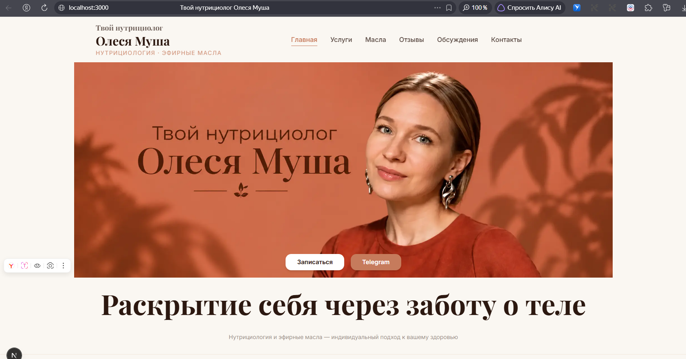
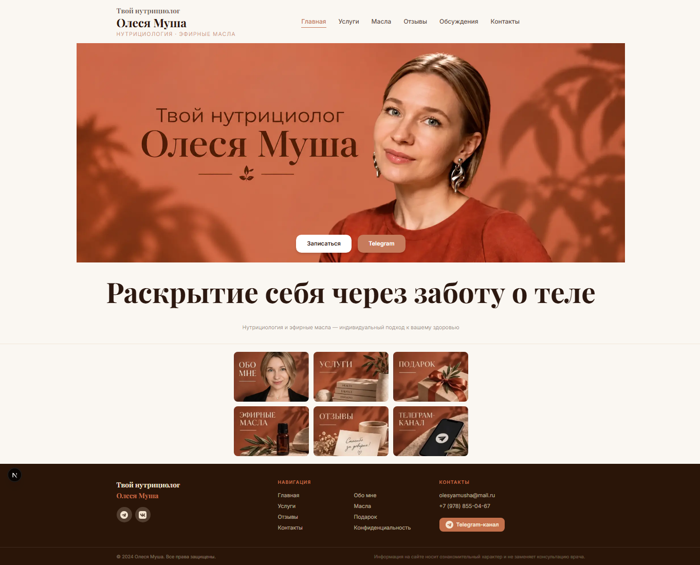
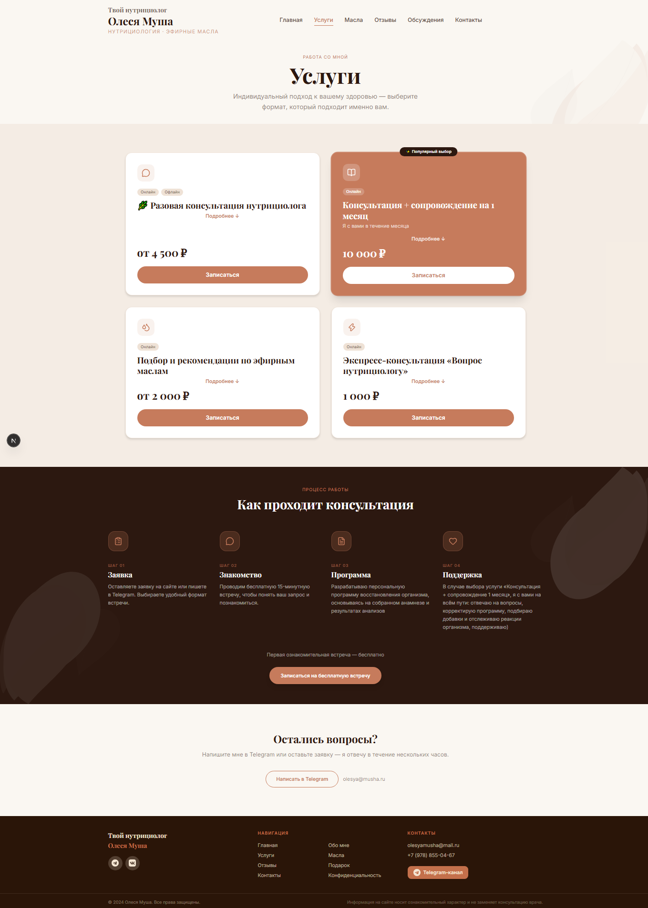
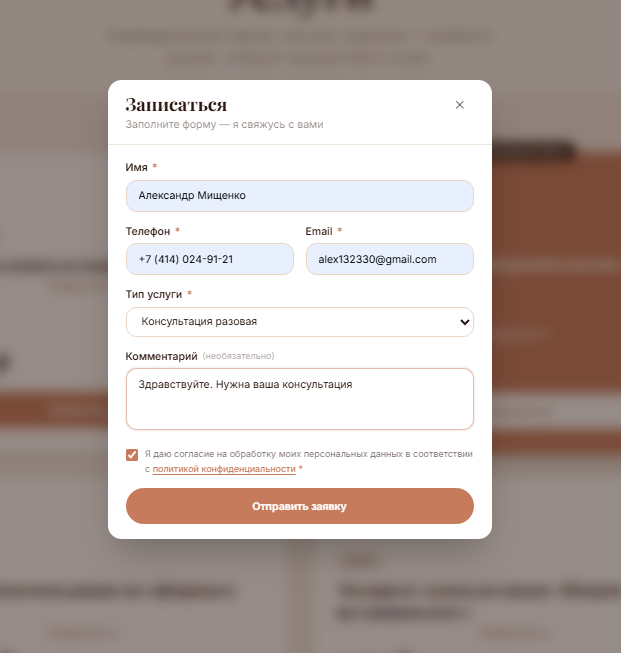
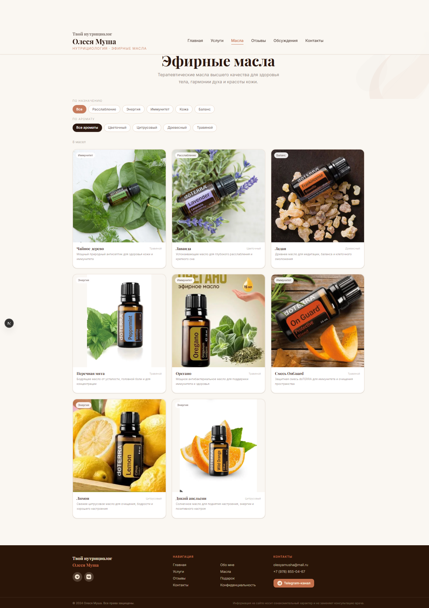
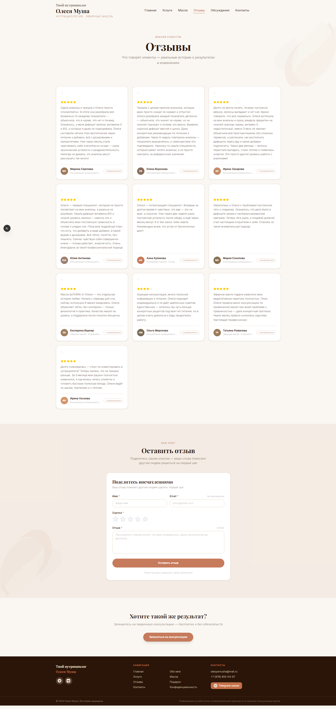
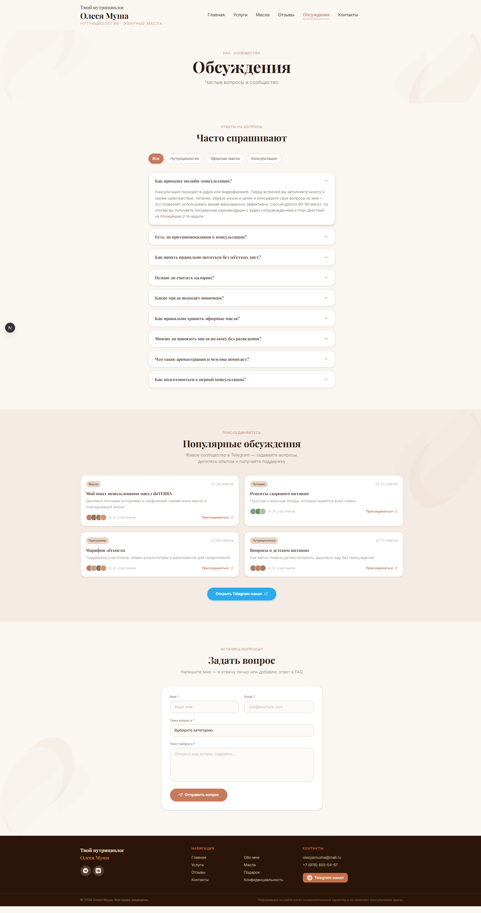
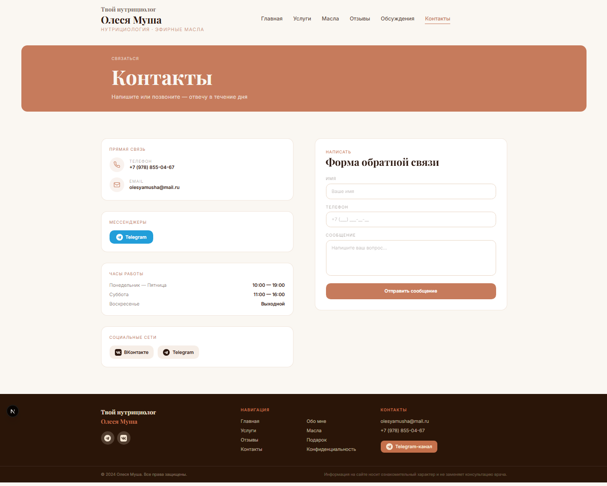

# Твой нутрициолог Олеся Муша

Персональный сайт нутрициолога **Олеси Муши** — специалиста по питанию и эфирным маслам. Сайт решает задачу онлайн-присутствия частного практика: знакомит потенциальных клиентов с экспертом, описывает услуги, позволяет записаться на консультацию, задать вопрос и купить авторские продукты (эфирные масла).





.png)














)

---

## Для кого этот сайт

**Целевая аудитория** — женщины, которые хотят наладить питание, улучшить самочувствие и интегрировать эфирные масла в повседневную жизнь. Сайт помогает:

- познакомиться с экспертом и убедиться в его компетентности;
- выбрать подходящий формат работы (разовая консультация, программа питания, подписка);
- записаться на консультацию через форму или Telegram;
- изучить каталог эфирных масел и добавить их в корзину;
- посмотреть видео и клипы с советами по питанию;
- прочитать ответы на частые вопросы и оставить свой вопрос.

---

## Функциональность

| Страница | Описание |
| --- | --- |
| `/` | Главная: hero-баннер, профиль эксперта, плитка разделов |
| `/services` | Услуги: карточки форматов работы, шаги «как это работает», бронирование через модальное окно |
| `/oils` | Каталог эфирных масел с карточками и добавлением в корзину |
| `/oils/[id]` | Страница отдельного масла |
| `/cart` | Корзина (Zustand, без бэкенда) |
| `/checkout` | Оформление заказа |
| `/reviews` | Отзывы клиентов + форма для нового отзыва |
| `/discussions` | Ответы на вопросы (FAQ) + форма для вопроса |
| `/videos` | Видеоматериалы |
| `/clips` | Короткие клипы |
| `/about` | О нутрициологе |
| `/gift` | Подарочный сертификат — лид-форма |
| `/contacts` | Контакты и форма обратной связи |
| `/telegram` | Редирект / виджет Telegram-канала |
| `/privacy-policy` | Политика конфиденциальности |

**Заявки и сообщения** отправляются через Telegram Bot API — письма падают сразу в личный чат нутрициолога.

---

## Технологический стек

| Технология | Версия | Роль |
| --- | --- | --- |
| **Next.js** | 16 (App Router) | Фреймворк, маршрутизация, SSR/SSG |
| **React** | 19 | UI |
| **TypeScript** | 5 | Типизация |
| **Tailwind CSS** | 4 | Стили через CSS-переменные |
| **shadcn/ui** | 4 | Базовые UI-компоненты |
| **react-hook-form + zod** | 7 / 4 | Формы и валидация |
| **zustand** | 5 | Состояние корзины |
| **sonner** | 2 | Toast-уведомления |
| **lucide-react** | 1 | Иконки |

---

## Дизайн-система

**Цветовая палитра** — тёплая, природная, женственная:

| Токен | HEX | Применение |
| --- | --- | --- |
| `cream` | `#FAF7F2` | Основной фон |
| `terracotta` | `#C67B5C` | Акцентный цвет, CTA |
| `beige` | `#E8D5C4` | Вторичные секции |
| `dark-brown` | `#2C1810` | Основной текст |
| `white` | `#FFFFFF` | Карточки, контрасты |

**Типографика:**
- `Playfair Display` — заголовки (`font-heading`)
- `Inter` — основной текст (`font-sans`)

---

## Структура проекта

```
/app              — страницы и маршруты (App Router)
  /actions        — серверные экшены (отправка Telegram)
  /[route]/       — каждый раздел сайта
/components
  /home           — секции главной страницы
  /layout         — Header, Footer, MobileBottomNav
  /oils           — компоненты каталога масел
  /services       — карточки услуг и модальное окно брони
  /reviews        — карточки и форма отзывов
  /discussions    — FAQ и форма вопроса
  /videos, /clips — видеоматериалы
  /gift           — лид-форма сертификата
  /ui             — shadcn/ui компоненты
/data             — статические данные (масла, услуги, отзывы, FAQ)
/lib              — утилиты
/types            — TypeScript типы
/public           — статика (изображения)
```

---

## Быстрый старт

```bash
# 1. Клонировать репозиторий
git clone https://github.com/alex132330-sketch/olesya-musha.git
cd olesya-musha

# 2. Установить зависимости
npm install

# 3. Настроить переменные окружения
cp .env.example .env.local
# Заполните .env.local своими значениями

# 4. Запустить dev-сервер
npm run dev   # http://localhost:3000
```

---

## Переменные окружения

| Переменная | Описание |
| --- | --- |
| `TELEGRAM_BOT_TOKEN` | Токен Telegram-бота для отправки заявок |
| `TELEGRAM_CHAT_ID` | ID чата, куда приходят заявки |
| `NEXT_PUBLIC_SUPABASE_URL` | URL проекта Supabase |
| `NEXT_PUBLIC_SUPABASE_ANON_KEY` | Anon-ключ Supabase |
| `NEXT_PUBLIC_SITE_URL` | Публичный URL сайта (для sitemap и метатегов) |

---

## Команды

| Команда | Описание |
| --- | --- |
| `npm run dev` | Dev-сервер с hot reload |
| `npm run build` | Продакшн-сборка |
| `npm run start` | Запуск собранного приложения |
| `npm run lint` | Проверка ESLint |

---

## Деплой на Vercel

1. Форкните или загрузите репозиторий на GitHub.
2. Откройте [vercel.com](https://vercel.com) → **Add New Project** → выберите репозиторий.
3. В разделе **Environment Variables** добавьте все переменные из `.env.example`.
4. Нажмите **Deploy** — Vercel автоматически определит Next.js и выполнит сборку.

После первого деплоя каждый пуш в `main` автоматически публикует новую версию.

---

## Лицензия

Проект создан для личного использования Олеси Муши. Все права защищены.
